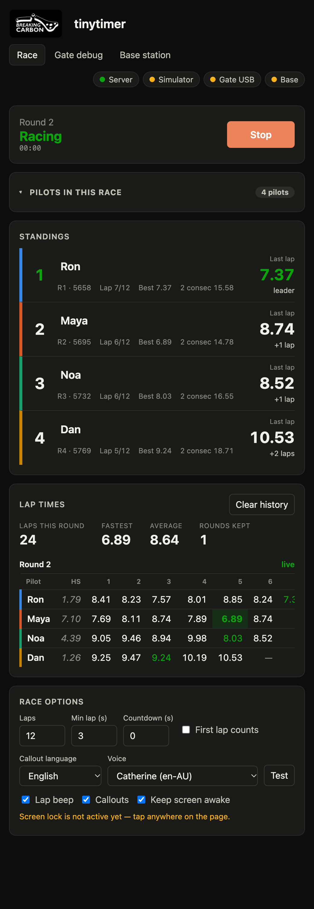
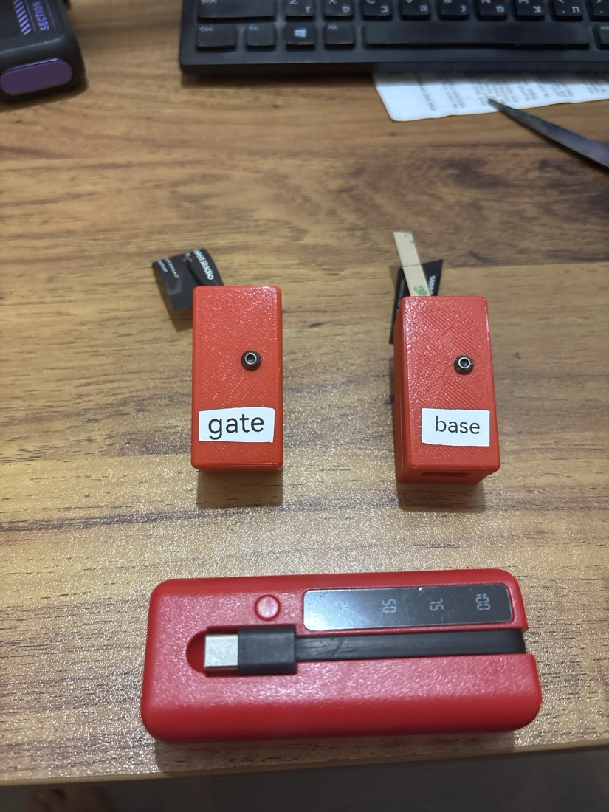
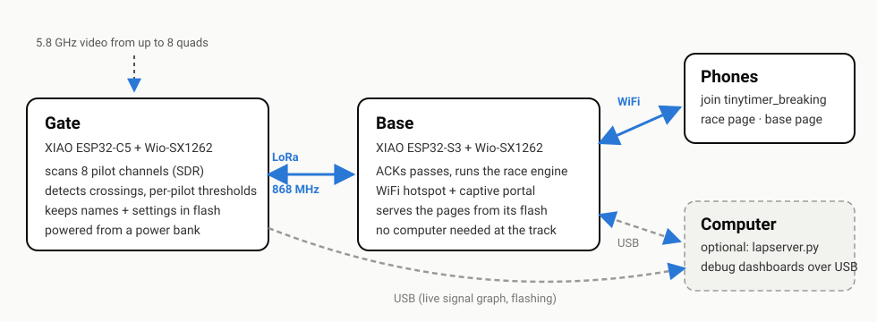
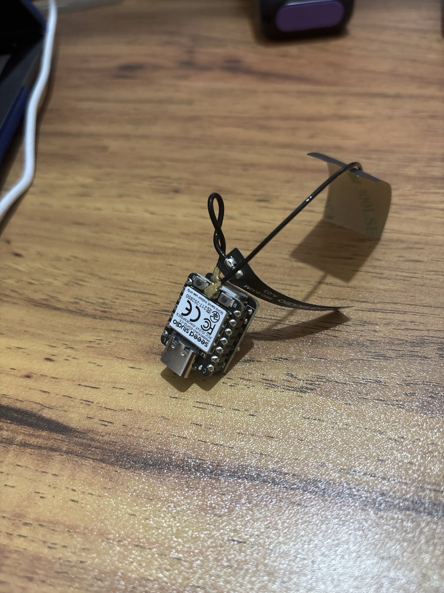
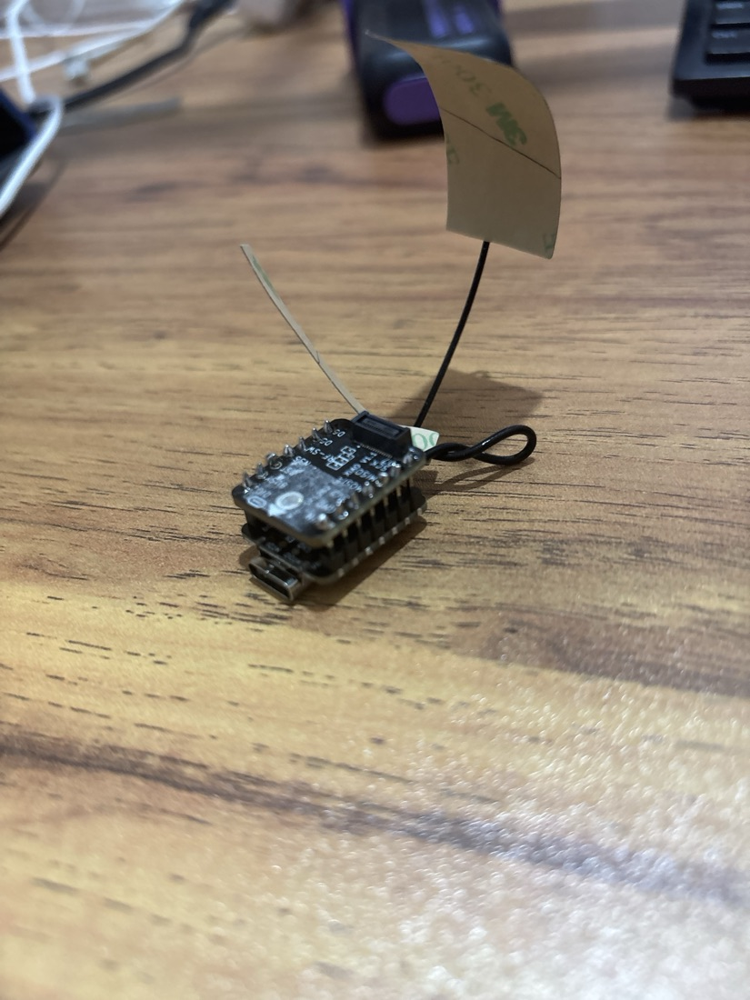
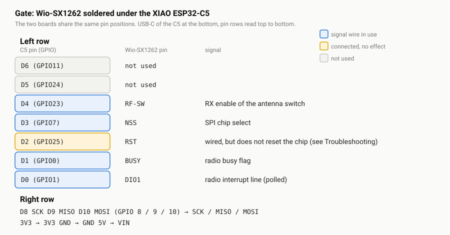
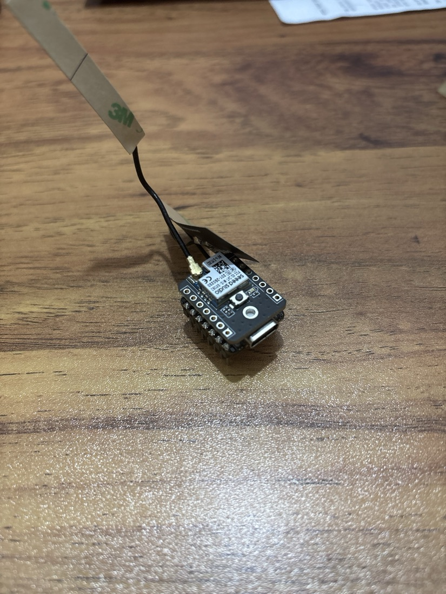
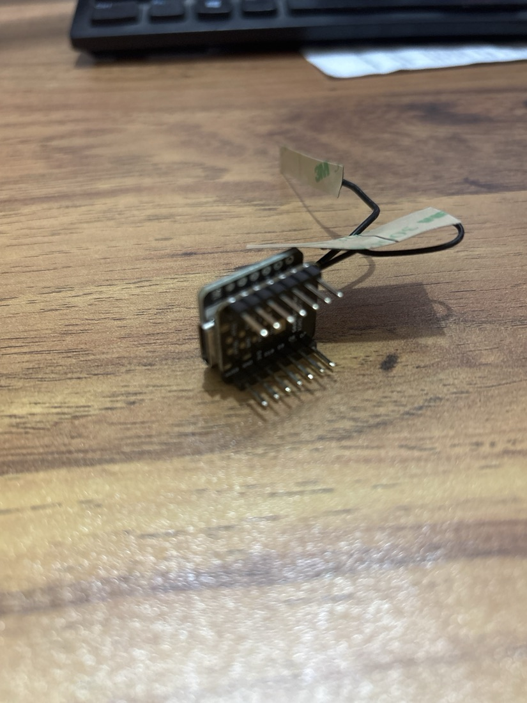
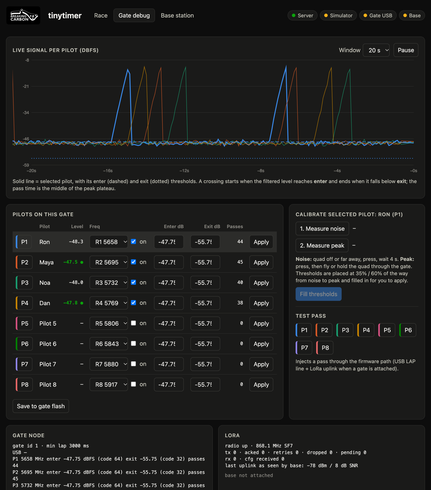

# tinytimer


**Analog FPV lap timing for up to 8 pilots, on two coin-sized boards.**
A tiny gate listens to the pilots' 5.8 GHz video channels, a tiny base station receives the laps
over LoRa and turns itself into a WiFi hotspot, and any phone that joins gets the race page. No laptop,
no wiring to the track.

<p>
  
  &nbsp;&nbsp;
  
</p>

*Left: the race page on a phone (demo data). Right: the gate and the base in their cases, with the 21700 battery pack that powers the gate.*

- [How it works](#how-it-works)
- [What you need](#what-you-need) · [Parts](#parts) · [Tools](#tools) · [Software](#software)
- [Assembly](#assembly) · [The gate](#the-gate) · [The base](#the-base) · [Antennas](#antennas-read-this-first)
- [Flashing](#flashing)
- [First run](#first-run)
- [Using it](#using-it) · [Race logic](#race-logic) · [Levels and thresholds](#levels-and-thresholds) · [Where settings live](#where-settings-live)
- [Troubleshooting](#troubleshooting)
- [Project layout](#project-layout) · [Credits and license](#credits-and-license)

---

## How it works



| Piece | What it does |
|---|---|
| **Gate** (XIAO ESP32-C5 + Wio-SX1262) | Uses the C5's WiFi radio as a software-defined receiver to measure up to 8 video channels at once. Detects each quad crossing, stamps it with its own clock, and sends it over LoRa. Keeps the pilot names, channels, thresholds and race options in its own flash. Needs only 5 V (a power bank). |
| **Base** (XIAO ESP32-S3 + Wio-SX1262) | Receives and acknowledges the gate's packets, runs the race (laps, hole shot, standings), and serves the web pages from its flash over its own open WiFi network **`tinytimer_breaking`**. A captive portal opens the page when a phone joins. |
| **Phones** | Join the hotspot and use the race page. Voice call-outs, lap beeps and the round history run in the phone's browser. |
| **Computer** (optional) | `server/lapserver.py` reads the gate and the base over USB and serves the same pages plus a live signal graph, for tuning and debugging. |

Lap times are exact: the difference of two stamps from the gate's own clock, so radio delay never touches them.

---

## What you need

### Parts

For one gate and one base:

| Qty | Part | Used for | Notes |
|---:|---|---|---|
| 1 | **Seeed Studio XIAO ESP32-C5** | gate | The 5 GHz capable one. It has **B** (boot) and **R** (reset) buttons and a USB-C port. |
| 1 | **Seeed Wio-SX1262 for XIAO** (LoRa module) | gate | The loose module with pin rows (see the photos). 868 MHz / 915 MHz versions exist; the firmware is set to 868.1 MHz. |
| 1 | **Seeed XIAO ESP32-S3 with Wio-SX1262** (the kit) | base | The kit includes the S3 and its LoRa module as a matched pair. |
| 2 | **860–930 MHz antenna with U.FL lead** | one per LoRa module | The small flexible Seeed antenna ("A-03") that ships with the modules is what the photos show. |
| 2 | **1×7 pin headers, 2.54 mm** | stacking the gate's two boards | Two strips for the gate stack (see photos). |
| 2 | **USB-C data cables** | flashing, powering | Must be data cables, not charge-only. |
| 1 | **USB power for the gate**: a **21700 battery power-bank case** (the red one in the photo below, with a built-in USB-C lead and a charge display) or any 5 V power bank | powering the gate away from a computer | A 21700 cell in a power-bank case gives many hours; the gate draws well under 1 W. |
| 2 | **Enclosure** (optional) | one for the gate, one for the base | The photo below shows 3D-printed cases with the USB-C port open at the bottom and the antenna leaving through the top. Any case works that keeps the antenna outside metal and USB-C reachable. |
| – | A phone with WiFi | race page | Any modern phone. |

> **Region.** The LoRa link runs on 868.1 MHz (EU SRD band, 1 % duty cycle: the firmware stays well under it).
> For another region change `LORA_FREQ_MHZ` in `gate/src/gate/lora_link.cpp` and `base/src/main.cpp` (they must
> match) and check your local rules.

### Tools

Soldering iron and solder (the gate needs ~14 joints), flux, tweezers, flush cutters, a multimeter with a
continuity buzzer, and a magnifier if your eyes are like mine.

### Software

| What | Why | Notes |
|---|---|---|
| **Git** | get the code | |
| **Python 3.9+** | PlatformIO and the optional computer-side server | 3.11 was used |
| **PlatformIO Core 6.2 or newer** | builds and flashes both boards | A distro/system `pio` older than 6.2 is too old for the pinned ESP32-C5 platform: install it in a virtual environment (below). The first build downloads the ESP-IDF based toolchain (a few hundred MB). |
| **pyserial** | the optional USB server | `pip install pyserial` |
| **A browser** | Chrome, Safari or Firefox | for the pages; Chrome on a computer for the debug pages |

```sh
git clone https://github.com/gilboash/espc5-rf-lap-timer.git tinytimer
cd tinytimer
python3 -m venv .venv
.venv/bin/pip install "platformio>=6.2" pyserial
```

Everything below that says `pio` means `.venv/bin/pio`. On Windows use `.venv\Scripts\pio`.

---

## Assembly

### Antennas: read this first

**Never power a LoRa module without its antenna attached.** Transmitting into an open U.FL connector can
damage the radio. Press the antenna's U.FL plug straight down onto the module's U.FL socket until it clicks,
then stick the flat antenna somewhere clear of metal and away from the board. Do this before the first power-up.

### The gate

The gate is the XIAO ESP32-C5 with the Wio-SX1262 soldered underneath it. The two boards use the same pin
positions, so the pins simply connect straight through.

<p>
  
  
</p>

*Left: the C5 on top. The two small buttons at its antenna end are **B** (boot) and **R** (reset); USB-C is at the
bottom. Right: the underside, where the LoRa module sits. Its silkscreen names the pins (RF-SW, NSS, RST, BUSY,
DIO1 on one row; SCK, MISO, MOSI, 3V3, GND, VIN on the other) and carries the U.FL antenna connector.*

1. **Line the boards up.** Hold the C5 with its USB-C port pointing towards you. The Wio-SX1262 goes under it with
   its silkscreen facing away from the C5 and its pin rows directly beneath the C5's two pin rows, antenna end to
   the antenna end. On the module the pin labels `DIO1, BUSY, RST, NSS, RF-SW` should sit under the C5's `D0, D1,
   D2, D3, D4`, and `SCK, MISO, MOSI` under `D8, D9, D10`.
2. **Place a 1×7 header through each of the two rows** so the long pins stick out of the module's side, and
   tack one pin on each strip while everything is held flat.
3. **Solder all pins** on both boards, about 14 joints. Keep the iron short on each joint: these boards are tiny
   and the pins are close together.
4. **Check for bridges.** With the multimeter on continuity, make sure no two neighbouring pins are connected,
   and that `3V3`, `GND` and `5V/VIN` are not shorted to each other.
5. **Attach the antenna** (see above).

What gets connected, so you can verify your joints:



| Wio-SX1262 pin | XIAO ESP32-C5 pin (GPIO) | Signal |
|---|---|---|
| NSS | D3 (7) | SPI chip select |
| BUSY | D1 (0) | radio busy flag |
| DIO1 | D0 (1) | radio interrupt line (polled) |
| RF-SW | D4 (23) | RX enable of the antenna switch |
| RST | D2 (25) | wired, but it does **not** reset the chip, see [Troubleshooting](#troubleshooting) |
| SCK / MISO / MOSI | D8 / D9 / D10 (8 / 9 / 10) | SPI |
| 3V3, GND, VIN | 3V3, GND, 5V | power |

These pins are set in `gate/src/gate/board_pins.h` if you wire it differently.

### The base

The base is the XIAO ESP32-S3 plus its Wio-SX1262 from the Seeed kit. The kit's radio talks to the S3 over fixed
internal connections (the pins are set in the base firmware), so no jumper wires are needed between them.

<p>
  
  
</p>

*The base. Left: the S3 with the Wio-SX1262 and its antenna lead. Right: the other side, with the header pins.
The base needs only the USB-C port for power.*

Attach the antenna before the first power-up, as above.

### The finished units


*The gate and the base in their cases, labelled, with the flat LoRa antenna leaving through the top of each. Below
them, the 21700 battery power-bank case that powers the gate at the track (its USB-C lead plugs straight into the
gate's USB-C port). The base can run from any USB power source; a second power bank works as well.*

Mount the gate where the quads pass, with its antenna clear of metal and carbon. The base can sit anywhere within
LoRa range (hundreds of metres in the open), with your phones within WiFi range of it.

---

## Flashing

You flash each board once over USB-C; after that all settings go over the air.

Plug **one board at a time** so you know which port is which. The ports show up as:

| OS | Looks like |
|---|---|
| macOS | `/dev/cu.usbmodem…` |
| Linux | `/dev/ttyACM…` |
| Windows | `COM…` |

**Gate** (XIAO ESP32-C5):

```sh
cd gate
../.venv/bin/pio run -e esp32c5 -t upload --upload-port /dev/cu.usbmodemXXXX
```

**Base** (XIAO ESP32-S3):

```sh
cd base
../.venv/bin/pio run -e base -t upload --upload-port /dev/cu.usbmodemYYYY
```

The base build also packs the web pages from `web/` into the firmware, so rebuild and reflash the base after
changing anything in `web/`.

The first build downloads the toolchain and takes a few minutes; later builds take seconds.

**If the upload cannot connect (put the board in download mode):**

- **C5 (gate):** hold **B**, tap **R**, release **B**, then run the upload again. The C5 sometimes leaves download
  mode after a failed attempt; if it will not come back, see the flashing notes in
  [`docs/upstream/widscan58-CLAUDE.md`](docs/upstream/widscan58-CLAUDE.md).
- **S3 (base):** unplug it, hold its **BOOT** button, plug it in, release.

**Check each board.** Easiest is the computer-side server, which finds both boards by what they answer:

```sh
.venv/bin/python server/lapserver.py       # then open http://localhost:8421/gate and /base
```

On the gate page type `LORA?` in the terminal. A good gate answers with `"up":1,"err":0`. If it says `"up":0`
the radio is not talking, see [Troubleshooting](#troubleshooting).

---

## First run

1. Power the **gate** (power bank or USB) and the **base**.
2. On a phone join the WiFi network **`tinytimer_breaking`** (no password). The race page should pop up by itself
   (a "sign in to network" page). If it does not, open **http://192.168.4.1**. If the phone asks, choose to stay
   connected although there is no internet. On an iPhone the pop-up is a limited window: use *Open in Safari* for a
   real race (sound and screen-lock need it).
3. The first status packet from the gate arrives within 15 seconds; the page shows the gate's pilots and settings.
4. **Race page:** tick the pilots who are flying, type their names (they are saved in the gate), pick their channels.
5. Press **Start** and fly. Each pass is beeped and called out, and appears in the standings and lap table.
6. If a pilot reads too eagerly or not at all, open the **Base station** page and calibrate (below).

---

## Using it

### Race page (`/`)


- **Roster:** tick a pilot to include them, type over a name to change it, pick a channel, set enter/exit thresholds.
- **Standings:** position, lap count, best lap, best two consecutive, last lap, gap.
- **Lap times:** a table per round (the hole shot **HS**, each lap, best, two consecutive, total). The fastest lap
  of the round is highlighted. Rounds are kept in the phone, newest first.
- **Race options:** target laps, minimum lap time, countdown, whether the first lap counts, callout language and voice,
  lap beep, keep-screen-awake.

### Base station page (`/base`)

Link health (RSSI and SNR charts, packet counters), the table of pilots with their channel, enter and exit thresholds
and a **Gate has** column that says whether the gate agrees with what you set, **calibration** (*Measure noise* with
the quads off, *Measure peak* with a quad held in the gate, *Fill suggested thresholds*, *Send all*), a **Live levels
over LoRa** graph, and the passes the base has received.

### Gate debug page (`/gate`, needs the gate on a computer's USB)



*Live signal per pilot (simulator data in this screenshot), with the selected pilot's enter (dashed) and exit (dotted)
thresholds, calibration, test passes and the gate's LoRa state.*

---

## Race logic

The race rules are ported from the Chorus32 race page (*Chorus32-LapTimerBreakingCarbon*):

- Pilot names are edited inline in the roster or the standings.
- The **hole shot** (start to the first gate crossing) is timed, but it counts as a lap only if *First lap counts*
  is ticked.
- **Nothing scores after a pilot takes the flag**, but later laps are still timed and shown struck through.
- Position is **laps first, then time on track.**
- A lead change, the last lap and every finish are announced; each crossing gets a beep pitched per pilot.
- Target laps defaults to 20 so a practice round does not end by accident.

The base keeps the raw laps of the current round (lap 0 is the hole shot) and streams them; the page derives
everything else. A phone that reloads mid-race rebuilds the round from the base, and the history stays in the phone.

## Levels and thresholds

The gate reports each pilot's level as **SNR**: dB above that channel's own noise floor, re-measured on every
capture. Absolute noise floors differ by several dB between channels, SNR does not, so one threshold shape fits
every pilot and follows gain changes. The pages show and accept **dB**.

A crossing **starts** when the smoothed level reaches **enter** and **ends** when it falls below **exit**; the pass
is stamped in the middle of the peak. Defaults are enter 16 dB / exit 8 dB. Calibrate for the real setup: with the
quads off *Measure noise*, with a quad in the gate *Measure peak*, then *Fill suggested thresholds* sets them 60 % and
35 % of the way from noise to peak.

## Where settings live

In the **gate's flash**: pilot names (12 bytes each), channels, thresholds, target laps, countdown, the hole-shot
option and the minimum lap time, saved a couple of seconds after any change. The base and the computer server keep
only a cache and **adopt what the gate reports**. An edit is sent to the gate (USB if attached, else over LoRa,
retried until confirmed) and shielded for 20 s from a stale report. A gate powered on its own therefore comes back
as it was left, and every phone shows the same thing. Still per phone: round history, callout language and voice,
beep, screen-awake.

---

## Troubleshooting

| Symptom | Likely cause and fix |
|---|---|
| Gate `LORA?` shows `"up":0,"err":-2` | The LoRa chip is not answering: check the solder joints of NSS, BUSY, SCK, MISO, MOSI and the 3V3/GND pins, and that the module is not shifted by one pin. |
| LoRa was fine and now nothing is received, or `err -705` | The module's reset line is not reachable from the C5, so the radio chip only resets when it loses power. **Unplug the gate's USB cable and plug it back in.** |
| The page never loads on the phone | Join `tinytimer_breaking`, say *stay connected* if asked, and open `http://192.168.4.1` (not https). On Android keep the page open once so the phone treats the network as usable. |
| The phone shows "no internet" | Expected. The hotspot has no internet; it only serves the race. |
| The base page shows **No heartbeat** / **Not connected** | That page is reading the base over USB (computer server); on the base's own hotspot this chip is always connected. |
| No readings at all | Check the channel plan (the gate defaults to R1–R8), that the quad's VTX is on, and run *Measure noise* / *Measure peak*. |
| A pilot is counted when another one flies | Cross-talk between seats. The passes table on `/base` has an **Other seat** column that shows which other pilot was strongest at that crossing. Raise that pilot's enter threshold above the leakage, or move a pilot to another channel. |
| Laps are missing | A pass lost over LoRa is retransmitted until acknowledged; check the link on `/base` (RSSI, SNR, "repeats", "dropped"). |
| The upload fails or the board will not appear | See [Flashing](#flashing): use a data cable, try another port, and use the BOOT/reset sequence. |
| Serial terminal shows nothing from the C5 | Its USB port is silent unless the host raises DTR; open it with DTR high. |

---

## Project layout

| Path | What |
|---|---|
| `common/lap_link.h` | LoRa wire format shared by gate and base |
| `gate/` | ESP-IDF/PlatformIO firmware for the C5 (GPL-3.0, derived from [Widscan58](https://github.com/CapnBry/widscan58)) |
| `gate/src/gate/` | pilot seats and pass detection (`gate.c`), USB events (`gate_io.c`), LoRa (`lora_link.cpp`), pins (`board_pins.h`) |
| `base/` | Arduino/PlatformIO firmware for the XIAO S3: LoRa (`src/main.cpp`), race engine and REST (`src/app.cpp`), hotspot, captive portal and pages (`src/web.cpp`); `embed_web.py` packs `web/` into the firmware at build |
| `server/lapserver.py` | the same engine and API on a computer, for the gate's USB debug path |
| `web/` | the pages (shared by the base and the computer server) |
| `docs/images/` | photos and diagrams used in this README |
| `docs/upstream/` | Widscan58's own notes (RF details, gain, flashing quirks) |
| `tests/lap_filter_test.c` | host test behind the EMA-filter default |

LoRa radio settings: 868.1 MHz, SF7, BW 250 kHz, CR 4/5, sync word 0x12, 14 dBm. Passes are retransmitted until
acknowledged (up to 12 tries, 3 per packet) and deduplicated by `(gate, pilot, count, gate time)`.

## Credits and license

- The receiver comes from [**Widscan58** by CapnBry](https://github.com/CapnBry/widscan58) (which builds on
  esp-sdr): turning the ESP32-C5's WiFi PHY into a multi-channel software-defined receiver. This project is a fork
  of that firmware, so it is **GPL-3.0** (see `LICENSE`).
- The race page's rules and call-out logic come from the **Chorus32-LapTimerBreakingCarbon** race page.
- The Breaking Carbon logo is Breaking Carbon's.
- Radio driver: [RadioLib](https://github.com/jgromes/RadioLib). Web server on the base:
  [ESPAsyncWebServer](https://github.com/ESP32Async/ESPAsyncWebServer).
